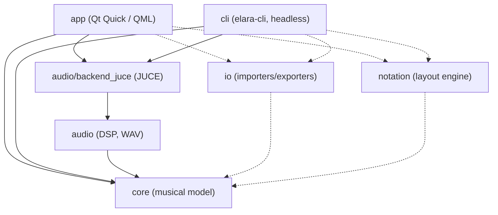

# Architecture

## Modules

Dashed modules do not exist yet. Boundaries are enforced twice: CMake target
links (a module can only use what it links) and `scripts/verify_architecture.py`
(include rules, run by `scripts/elara.py check`).

| Module | Target | Responsibility | Milestone |
|---|---|---|---|
| `src/core` | `elara_core` | Musical model, commands with undo/redo | 1 |
| `src/io` | `elara_io` | Native `.elara` format (ADR-0006), MusicXML import and export (ADR-0007, ADR-0008), MIDI import and export (ADR-0009), Guitar Pro 7-8 import (ADR-0010) | 1, 2 |
| `src/notation` | `elara_notation` | Layout of tablature and staff into a display list | 3 |
| `src/audio` | `elara_audio` | Real-time-safe DSP, sequencer, offline rendering, WAV | 0, 4 |
| `src/audio/backend_juce` | `elara_audio_juce` | System audio devices via JUCE; synths (FluidSynth, sfizz) | 0, 4 |
| `src/cli` | `elara-cli` | Headless access to every feature, JSON output | 0+ |
| `src/app` | `elara` | Qt Quick UI; draws the notation display list with the Qt scene graph | 0+ |

## Key decisions

- **One model, many views.** Tablature, staff, piano roll and timeline read the
  same `elara_core` objects (`Song > Track > Staff > Measure > Voice > Beat >
  Note`, ADR-0004). A live song is a `Document`: every edit is a reversible
  command, so undo/redo is uniform (ADR-0005).
- **Notation is a pure function.** `elara_notation` turns the model into a
  display list (glyphs, lines, positions) without Qt. The app renders that list
  with the Qt scene graph; tests snapshot it as SVG/JSON. Re-layout is
  incremental per system.
- **Qt draws, JUCE plays** (ADR-0002). JUCE is used as a headless library inside
  `elara_audio_juce`; nothing else sees JUCE types.
- **Headless first** (ADR-0003). Every feature is reachable from `elara-cli` and
  verifiable by tests without a screen or speakers.

## Threads

| Thread | Owner | Rules |
|---|---|---|
| Main / GUI | Qt event loop (also JUCE's message thread) | Owns the model; all edits happen here |
| Audio callback | JUCE device | No allocation, locks, I/O or logging; reads immutable snapshots / lock-free queues |
| Workers (future) | Thread pool | Layout of large scores, file import, offline render |

Open question (milestone 4): on Linux, Qt's event loop does not service JUCE's
message queue. Device-change notifications may need a dedicated JUCE message
thread there. Tracked in ADR-0002.
